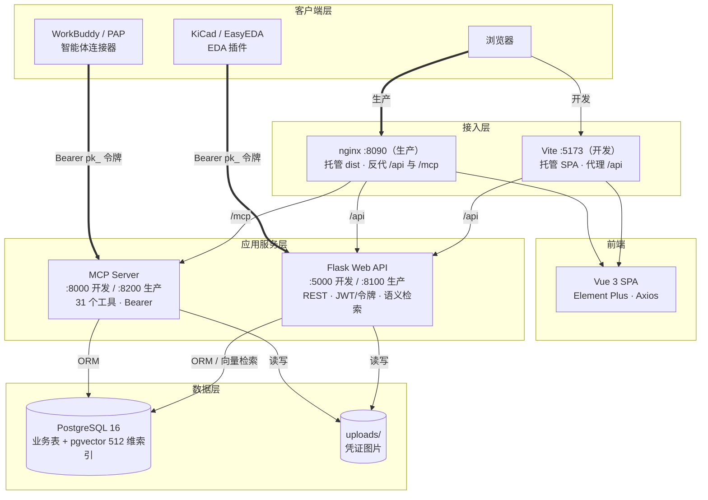

# PartKeeper 物料与家庭物品管理系统

轻量级 B/S 架构系统，用于个人或小团队管理电子元器件库存，并覆盖家电、家具、车辆等家庭物品及其购置、维护与开支。SQLite 单文件存储，零数据库部署。

## 系统架构



细线为开发链路，粗线为生产链路。

- **开发态**：Vite `:5173` 托管 SPA 并把 `/api` 代理到 Flask `:5000`；MCP Server 单独启动在 `:8000`。
- **生产态**：nginx `:8090` 托管 `frontend/dist`，`/api` 反代到 gunicorn `:8100`，`/mcp` 反代到 MCP Server `:8200`。Web 与 MCP 是两个独立进程，共享同一个 PostgreSQL 库——因此 Web 上撤销令牌，MCP 下一次请求立即失效。
- **EDA 插件**：KiCad 插件走 `/api/integrations/bom/match` 直接提交板上的元件清单，不再需要导出 CSV 再上传；EasyEDA 扩展同理。
- **数据层**：业务表与 512 维向量存在同一个 PostgreSQL 库（pgvector 扩展 + HNSW 余弦索引），物品变更时同步更新向量；凭证图片落磁盘 `uploads/`，按内容 SHA-256 命名、剥离 EXIF。

## 技术栈

- 前端：Vue 3 + Element Plus + Axios + Vue Router + Vite
- 后端：Python 3.10+ + Flask + Flask-SQLAlchemy；MCP Server 基于 FastMCP（Streamable HTTP）
- 数据库：PostgreSQL 16 + pgvector（业务数据与向量同库）
- 向量化：fastembed + `BAAI/bge-small-zh-v1.5`（512 维，ONNX 本地推理，无需 GPU/API Key）
- 认证：Web 用 JWT；MCP 与插件用 Bearer 令牌（Web 发放的 `pk_` 令牌或 admin JWT）

## 目录结构

```
PartKeeper/
├── backend/
│   ├── app.py            # 应用入口：工厂函数、蓝图注册、建表与轻量迁移
│   ├── mcp_server.py     # MCP Server：31 个工具与 Bearer 鉴权
│   ├── config/           # 配置
│   ├── models/           # SQLAlchemy 模型（含 item_embeddings 向量表）
│   ├── routes/           # REST 控制器（含 integrations 插件直连）
│   ├── services/         # 业务逻辑（库存过账、令牌、维护账本、向量检索、BOM 匹配）
│   ├── scripts/          # 建表初始化、SQLite→PostgreSQL 迁移
│   ├── utils/            # JWT、密码哈希、鉴权装饰器
│   └── .env.example      # 环境变量模板（不含真实密钥）
├── frontend/             # Vue 3 前端
├── plugins/
│   ├── kicad/            # KiCad 插件（Python ActionPlugin，可打 PCM 包）
│   └── easyeda/          # EasyEDA 标准版扩展（JS）
├── deploy/               # 生产部署参考配置
├── docs/                 # 设计与使用文档
└── start*.ps1            # Windows 一键启动脚本
```

## 快速开始

### 1. 启动 PostgreSQL

使用带 pgvector 的官方镜像，应用启动时会自动建表并创建向量索引：

```bash
docker run -d --name partkeeper-postgres \
  -e POSTGRES_USER=partkeeper \
  -e POSTGRES_PASSWORD=your-password \
  -e POSTGRES_DB=partkeeper \
  -p 127.0.0.1:5433:5432 \
  -v partkeeper-pgdata:/var/lib/postgresql/data \
  pgvector/pgvector:pg16
```

端口用 5433 是为了避开本机可能已有的 PostgreSQL（默认 5432）。

### 2. 配置环境变量

```bash
cd backend
copy .env.example .env    # macOS/Linux: cp .env.example .env
```

`.env` 含密钥，已被 `.gitignore` 排除，不会提交到仓库。至少要改 `DATABASE_URL` 里的密码与 `SECRET_KEY`。

### 3. 启动后端

```bash
cd backend
python -m venv .venv
# Windows: .venv\Scripts\activate   macOS/Linux: source .venv/bin/activate
pip install -r requirements.txt
python app.py
```

默认运行在 `http://localhost:5000`，启动时自动建表、补充常用分类并创建初始管理员。首次调用语义检索会下载约 100MB 的 embedding 权重。

### 4. 启动前端

```bash
cd frontend
npm install
npm run dev
```

默认运行在 `http://localhost:5173`，`/api` 请求已代理到后端。

## 默认账号

| 用户名 | 密码 | 角色 |
|--------|------|------|
| admin  | admin123 | 管理员 |

以上为本地开发默认值，可通过 `backend/.env` 的 `ADMIN_USERNAME` / `ADMIN_PASSWORD` 修改。正式使用前务必更换 `SECRET_KEY` 和管理员密码。

## 主要功能

- **物品管理**：`items` 主表统一管理电子元器件、家电、家具、车辆等；类型专有属性放 `item_specs` 扩展表，新增类型不改主表结构。支持多条件搜索、CRUD 与低库存预警。
- **语义检索**：用自然语言按参数找料——「十千欧的贴片电阻」「一百微法的电解电容」都能召回，不必记住具体写法。向量存 pgvector，物品变更时自动增量更新。
- **EDA 插件直连**：KiCad 插件与 EasyEDA 扩展可在编辑器内直接提交当前板/原理图的元件清单，返回匹配与缺口，一键创建缺失物料，取代「导出 CSV → 网页上传」。
- **库存作业**：入库 / 出库、库存流水、BOM 清单与 EDA 的 CSV 导入、按 BOM 批量出库。
- **统计分析**：采购与消耗趋势、供应商与分类金额分布、Top 物料、库存估值，支持时间筛选与 CSV 导出。
- **家庭收支**：水电煤等生活缴费与 12 类家庭开支分开记账；支持凭证图片上传、EXIF/GPS 剥离、按内容哈希去重。
- **物品账本**：维护记录可自动生成维修开支并挂到物品，按物品汇总购置成本、维修成本与年均持有成本。
- **首页概览**：本月与近 6 月家庭支出、堆叠趋势、最近开支与出入库动态。
- **系统管理**：用户与角色管理；管理员可在 Web 端发放、撤销访问令牌。

## 对外接入（MCP）

MCP Server 提供 31 个工具，供 WorkBuddy、PAP 等智能体查询库存与统计、录入缴费与开支、登记物品维护，并支持按参数语义检索物料。管理员登录后进入侧边栏「访问令牌」生成长期凭证，明文仅显示一次，可随时撤销。

WorkBuddy 配置（`~/.workbuddy/mcp.json`）：

```json
"partkeeper": {
  "type": "streamableHttp",
  "url": "http://127.0.0.1:8000/mcp",
  "headers": {
    "Authorization": "Bearer <访问令牌>"
  },
  "timeout": 60000
}
```

修改 `mcp.json` 后需重启 WorkBuddy 会话生效。生产环境的端点地址以 Web「访问令牌」页显示的信息为准。

完整工具清单、令牌认证细节、字段说明与家庭场景用法见 [MCP 接入与接口参考](docs/MCP接入指南.md)。

## 生产部署

| 端口 | 归属 | 说明 |
|------|------|------|
| 5433 | PostgreSQL | pgvector 容器，只监听 127.0.0.1 |
| 8090 | nginx | Web 站点，配置见 `deploy/nginx-partkeeper.conf` |
| 8100 | gunicorn | Flask 后端，只监听 127.0.0.1 |
| 8200 | MCP Server | 只监听 127.0.0.1，经 8090 的 `/mcp` 反代暴露 |

改完 `backend/.env` 后必须重启对应服务：`EnvironmentFile` 只在进程启动时注入。`MCP_PUBLIC_URL` 用于生成页面上显示的端点地址，反向代理或换域名后务必显式配置。

### 从 SQLite 迁移

旧版本使用 SQLite。迁移步骤（目标库需先建表）：

```bash
# 1. 在目标 PG 上建表、装 pgvector 扩展、建 HNSW 索引
DATABASE_URL=postgresql+psycopg://... python scripts/init_pg_schema.py

# 2. 预演，只统计不写入
DATABASE_URL=postgresql+psycopg://... \
  python scripts/migrate_sqlite_to_pg.py --source instance/app.db --dry-run

# 3. 正式迁移（--truncate 先清空目标表的种子数据）
DATABASE_URL=postgresql+psycopg://... \
  python scripts/migrate_sqlite_to_pg.py --source instance/app.db --truncate
```

脚本保留主键并重设序列，结束时逐表核对行数；任一表不一致会以非零码退出，不要在这种状态下切服务。切换只需改 `DATABASE_URL` 并重启两个 systemd 单元，回滚就是把该行改回 `sqlite:///app.db`。

### 语义索引维护

- 新建/修改物品时自动增量更新向量，文本未变则跳过（不重复调模型）；
- 批量导入历史数据、或换了 embedding 模型后，调用 `POST /api/components/semantic-reindex`（管理员，body `{"force": true}`）全量重建；
- `GET /api/components/semantic-status` 返回 `items` / `embedded` / `missing`，可用于巡检。

## 更多文档

- [使用说明](docs/使用说明.md) —— 安装启动与各功能操作
- [MCP 接入与接口参考](docs/MCP接入指南.md) —— 工具清单、认证、字段与接口细节
- [KiCad 插件](plugins/kicad/README.md) / [EasyEDA 扩展](plugins/easyeda/README.md) —— 安装与使用
- [设计方案与实现说明](docs/物料管理系统开发规划.md) —— 需求、ER 模型与后端接口设计
