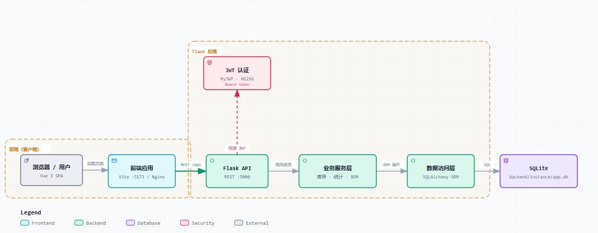

# PartKeeper 电子元器件物料管理系统

轻量级 B/S 架构物料管理系统，用于个人或小团队管理电子元器件库存。

## 技术栈

- 前端：Vue 3 + Element Plus + Axios + Vue Router + Vite
- 后端：Python 3.10+ + Flask + Flask-SQLAlchemy
- 数据库：SQLite 3（单文件，零部署）
- 认证：JWT（前后端分离）

## 系统架构



> 矢量源文件见 [docs/partkeeper.svg](docs/partkeeper.svg)。

## 目录结构

```
PartKeeper/
├── backend/            # Flask 后端
│   ├── app.py          # 应用入口（工厂函数、蓝图注册、建表、种子管理员）
│   ├── config/         # 配置
│   ├── models/         # SQLAlchemy 模型
│   ├── routes/         # 控制器层
│   ├── services/       # 业务逻辑层（库存过账）
│   ├── utils/          # 工具（JWT、密码、装饰器）
│   └── .env.example    # 环境变量示例
├── frontend/           # Vue 3 前端
└── docs/               # 文档与架构图
    ├── 物料管理系统开发规划.md   # 设计方案与实现说明
    ├── 使用说明.md              # 使用说明
    └── partkeeper.svg / partkeeper-architecture.png   # 运行时架构图
```

## 快速开始

### 1. 配置环境变量

本项目使用 SQLite，无需单独安装数据库服务。首次启动会自动在 `backend/instance/` 下生成数据库文件。

复制环境变量模板并按需修改（`.env` 不会被提交到仓库）：

```bash
cd backend
copy .env.example .env    # macOS/Linux: cp .env.example .env
```

### 2. 启动后端

```bash
cd backend
python -m venv .venv
# Windows: .venv\Scripts\activate   macOS/Linux: source .venv/bin/activate
pip install -r requirements.txt
python app.py
```

后端默认运行在 `http://localhost:5000`，启动时会自动建表、补充常用分类并创建初始管理员。

### 3. 启动前端

```bash
cd frontend
npm install
npm run dev
```

前端默认运行在 `http://localhost:5173`，开发服务器已配置将 `/api` 请求代理到后端 `http://localhost:5000`。

## 默认账号

| 用户名 | 密码 | 角色 |
|--------|------|------|
| admin  | admin123 | 管理员 |

> 以上为本地开发默认值，可通过 `backend/.env` 中的 `ADMIN_USERNAME` / `ADMIN_PASSWORD` 修改；生产或正式使用前请务必更换 `SECRET_KEY` 和管理员密码。`.env` 已被 `.gitignore` 排除，不会提交到仓库。

更详细的功能使用说明见 [使用说明.md](docs/使用说明.md)。

## 主要功能

- 物品管理：一张 `items` 主表统一管理电子元器件、家电、家具、车辆等，多条件搜索、分页、CRUD，关联分类/库位/供应商；类型专有属性放 `item_specs` 扩展表，新增类型不必改主表结构
- BOM 导入：上传常见 EDA 导出的 CSV 物料清单，自动匹配现有库存、标记缺口，并可一键创建缺失物料
- BOM 管理：维护常用物料清单（物料 + 数量），出库时可选 BOM 批量出库，批量表格支持增删改数量
- 分类管理：树形多级分类
- 供应商 / 库位管理：CRUD
- 入库 / 出库操作：自动更新库存，出库校验库存；入库支持记录可选单价
- 库存流水：按物料、类型、时间段过滤
- 低库存预警：高亮展示低于阈值的物料
- 统计分析：采购 / 消耗概览、月度趋势、Top 组件、供应商与分类金额分布、库存估值；支持按时间范围筛选并导出 CSV
- 生活缴费：水/电/燃气/宽带/话费账单录入与核对，支持支付宝、微信、银行代扣、现金等任意渠道；按「渠道 + 单号」或「渠道 + 类型 + 金额 + 日期 + 收款方」双重去重，重复截图不会重复计账
- 家庭开支：教育、培训、旅行、娱乐、购物、医疗等 12 类开支记录，支持凭证图片上传（自动剥离 EXIF/GPS）、列表缩略图、多条件筛选与月度统计；可关联到具体物品，用来算「这台机器总共花了多少」
- 物品维护与持有账本：为物品记录清洁/维修/换耗材/巡检历史，填了花费自动生成一笔维修开支并挂到该物品；按物品汇总总投入、购置成本、维修成本、年均持有成本与保修剩余
- 首页概览：本月与近 6 月家庭支出（缴费 + 开支），堆叠趋势图，最近开支与最近出入库
- 用户管理：管理员专属，角色区分

## 统一 API 返回格式

```json
{
  "code": 200,
  "message": "success",
  "data": {}
}
```

主要接口前缀为 `/api`，详见 [物料管理系统开发规划.md](docs/物料管理系统开发规划.md) 第 6 节。

## MCP 对外通信（供 WorkBuddy 连接器访问）

PartKeeper 提供独立的 MCP Server（Streamable HTTP + Bearer 认证），与 Web Server 共享同一 SQLite 数据库，供 WorkBuddy 自定义连接器调用物料查询、统计与出入库能力。

### 启动

```powershell
# 单独启动 MCP Server（默认 0.0.0.0:8000，端点 /mcp）
powershell -ExecutionPolicy Bypass -File .\start_mcp.ps1

# 或使用一键脚本（会同时拉起前端、后端与 MCP Server）
powershell -ExecutionPolicy Bypass -File .\start.ps1
```

### 生产部署与端口分配

同机还跑着 `personal-agent-platform`，端口不能串用。当前分配：

| 端口 | 归属 | 说明 |
|------|------|------|
| 80 | pap | pap 的 default_server（Basic Auth 网关），**PartKeeper 不碰** |
| 8080 | pap | 已划给 pap 使用，**PartKeeper 不得占用** |
| 8090 | PartKeeper Web | nginx 站点，见 `deploy/nginx-partkeeper.conf` |
| 8100 | PartKeeper 后端 | gunicorn，只听 127.0.0.1 |
| 8200 | PartKeeper MCP | 只听 127.0.0.1，经 8090 的 `/mcp` 反代暴露 |

改完 `backend/.env` 后**必须重启对应 systemd 单元**：`EnvironmentFile` 只在进程启动时注入，`MCP_PUBLIC_URL` 改了不重启 `partkeeper-web`，页面上的连接地址仍是旧值。

### 认证

所有请求需在 Header 携带 `Authorization: Bearer <token>`，令牌支持三种来源，按顺序校验：

| 令牌 | 来源 | 适用 |
|------|------|------|
| `pk_...` 访问令牌 | Web 端「访问令牌」页面生成 | **推荐**。可命名、可设有效期、可随时撤销，撤销后下一次请求即失效，无需重启服务 |
| `MCP_API_KEY` | `backend/.env` 静态密钥 | 全局共用的应急密钥，改一次要重启服务 |
| admin JWT | Web 登录签发 | 有效期仅 `JWT_EXPIRATION_HOURS`（默认 24h），适合临时调试 |

未携带或无效 token 返回 `401`。

### 访问令牌（Web 发放）

管理员登录后进入侧边栏「访问令牌」：

1. 点「生成令牌」，填名称（如 `WorkBuddy 连接器`）与有效期（30/90/365 天或永久）；
2. 明文令牌**只在生成时显示一次**，弹窗内提供「复制令牌」与「复制端点 + 令牌」；
3. 列表展示前缀、状态（可用 / 已过期 / 已撤销）、最后使用时间与有效期，可随时撤销。

安全设计：

- 库里**只存 SHA-256 摘要**，明文不落库；`prefix`（`pk_` + 8 位）仅用于列表辨识，无法还原原文。
- 令牌绑定创建者，且要求 `role=admin`——用户被降级后令牌立即失效，不必等管理员手动撤销。
- 撤销为软删除（置 `revoked_at`），保留审计痕迹；重复撤销返回 `400`。
- `last_used_at` 每 5 分钟最多写一次库，避免每次工具调用都产生写事务。
- 单用户活跃令牌上限 20 个，防止误点生成。

接口（管理员）：

| 方法与路径 | 说明 |
|-----------|------|
| `GET /api/tokens` | 列表 + 统计（total/active/revoked/expired） |
| `POST /api/tokens` | 生成，body `{name, expires_in_days}`（0 或缺省 = 永久），**响应含明文** |
| `DELETE /api/tokens/<id>` | 撤销 |
| `GET /api/tokens/meta` | 连接信息（MCP 端点、活跃上限、是否配置了静态密钥） |

MCP 端点地址优先读环境变量 `MCP_PUBLIC_URL`；未配置时按「当前访问主机名 + `MCP_PORT` + `MCP_PATH`」推断，反代或换域名后务必显式配置。

### 可用工具（30 个）

| 工具 | 说明 |
|------|------|
| `list_components` | 物品列表，支持关键词（名称/值/封装/品牌）/分类/低库存过滤，返回含 `kind` 类型 |
| `get_component` | 按 ID 查物品详情（含类型、消耗品/保修/维护属性） |
| `create_component` | 新建物品档案，`kind` 支持 electronic/appliance/furniture/vehicle/other；分类/库位/供应商按名称自动关联；支持消耗品与保修维护字段 |
| `list_low_stock` | 低库存预警清单 |
| `get_replenishment_suggestions` | 消耗品补货建议：按消耗速率估算剩余天数、建议补货量与紧急度 |
| `list_expiring_warranties` | 保修到期与维护到期扫描（含已过期） |
| `list_categories` | 分类树 |
| `list_suppliers` / `list_locations` | 供应商 / 库位 |
| `list_transactions` | 库存流水（按类型、日期过滤） |
| `get_stats_overview` | 库存与采购/消耗总览 |
| `get_purchase_ranking` / `get_consumption_ranking` | 采购 / 消耗排行 |
| `get_monthly_trend` | 月度趋势 |
| `get_purchase_spend` | 采购支出看板：月度金额、分类/供应商排行、最大开销月 |
| `stock_in` / `stock_out` | 入库 / 出库（记录操作人为 `MCP_OPERATOR_ID`） |
| `record_utility_bills` | 批量录入水电煤等生活缴费账单（自动去重，返回新增/重复/失败明细） |
| `list_utility_bills` | 查询缴费账单明细（按类型/日期过滤） |
| `delete_utility_bill` | 删除误录账单（纠错用） |
| `get_utility_spend` | 缴费支出归总：月度趋势 + 按类型/收款方汇总 |
| `record_expenses` | 批量录入教育/培训/旅行/娱乐/购物/医疗等各类开支（自动去重，可登记凭证） |
| `attach_expense_receipt` | 给已有开支补挂凭证图片（自动剥离 EXIF/GPS，按内容哈希去重） |
| `list_expenses` | 查询开支明细（按类型/子类/商户/渠道/日期/关键词过滤，附凭证） |
| `delete_expense` | 删除误录开支（纠错用，磁盘文件保留） |
| `get_expense_spend` | 开支归总：月度趋势（零填充）+ 按类型/子类/商户/渠道汇总 |
| `get_household_spend_overview` | 家庭总支出看板：合并缴费与开支，总额/月度/分类排行 |
| `record_maintenance` | 记录物品维护（清洁/维修/换耗材/巡检）；填了花费自动生成维修开支并挂到物品 |
| `list_maintenances` | 查询维护历史（按物品/类型/日期/关键词过滤） |
| `get_component_ledger` | 物品持有账本：购置成本、维修成本、总投入、维修次数、年均成本、保修剩余 |

### 家庭场景字段说明

`create_component` 支持以下可选属性，供补货提醒与维护提醒使用：

| 字段 | 类型 | 说明 |
|------|------|------|
| `is_consumable` | bool | 是否消耗品，补货建议默认只扫描标记为 true 的物品 |
| `consumption_rate` | float | 消耗速率（单位/天）；留空则从最近 90 天出库流水自动推算 |
| `warranty_expiry` | date | 保修到期日，格式 `YYYY-MM-DD` |
| `maintenance_cycle_days` | int | 维护周期（天） |
| `last_maintenance_date` | date | 上次维护日期，格式 `YYYY-MM-DD` |

这 5 个字段是与物品类型无关的通用属性，后续模型重构为 `Item` 主表 + 类型扩展表时可直接平移。已有数据库在应用启动时由 `backend/app.py` 的 `migrate()` 自动补列，无需手工处理。

### 生活缴费账单（各渠道缴费截图）

在 WorkBuddy 中直接发支付宝、微信、银行代扣等任意渠道的生活缴费清单截图，说明「录入这些缴费」，模型会从图中提取账单并调用 `record_utility_bills` 批量写入。

**渠道字段 `channel`**：`alipay`（支付宝）、`wechat`（微信）、`bank`（银行代扣）、`cash`（现金）、`other`（其他，默认）。兼容中文传参——「支付宝」「微信」「银行代扣」「现金」会自动归一化到对应英文值。

**去重机制**（避免同一笔交易在多张截图中重复计入）：
1. 有渠道交易单号（`external_id`）时，以「渠道 + 单号」为键——**同一串单号在支付宝和微信属于两笔不同交易，不会误合并**。
2. 无单号时，以「渠道 + 类型 + 金额（精确到分）+ 缴费日期 + 收款方」规范化取 SHA-256。同日不同时刻视为同一笔，不同日期或不同收款方不合并。

每条账单支持 `category`（water/electricity/gas/internet/phone/other）、`amount`、`paid_at`、`channel`、`period`、`counterparty`、`external_id`、`source`、`note`。录入结果按「新增 / 重复跳过 / 格式失败」三类分别返回，重复项不会写入也不会报错。

误录时用 `list_utility_bills`（支持按 category/channel/日期过滤）找到 `id`，再调 `delete_utility_bill` 删除即可。统计用 `get_utility_spend`，`group` 可选 `category`（按水电煤类型）、`counterparty`（按收款方）、`channel`（按缴费渠道）。

### 家庭各类开支（教育/培训/旅行/娱乐等）

水电煤等**生活缴费**走 `utility_bills`；其余开支（教育、培训、旅行、娱乐、购物、医疗、餐饮、交通、居住、数码、维修保养、其他）走 `expenses` 表。两表物理分开、统计时归一——生活缴费有「账期」「收款方」这类特化语义，混进同一张表会让字段全部变可空、语义崩坏。

同一笔支出**只记一处**。若既记入缴费又记入开支，`get_household_spend_overview` 会重复计算。

```text
把这几笔开支记一下：
- 英语培训 3800，新东方，微信，9月1日
- 机票 1860，携程，支付宝，10月2日
- 电影票 96，万达影城，微信，10月5日
```

模型会调用 `record_expenses` 批量写入。每条支持：

| 字段 | 必填 | 说明 |
|------|------|------|
| `category` | 是 | 中文或英文均可，如 `教育`/`education`、`旅行`/`travel` |
| `amount` | 是 | 金额（元），必须大于 0 |
| `occurred_at` | 是 | 消费发生时间，`YYYY-MM-DD` 或 `YYYY-MM-DD HH:MM` |
| `subcategory` | 否 | 自由文本细分，如「英语培训」「机票」「电影」 |
| `merchant` | 否 | 商户 / 机构 / 平台 |
| `channel` | 否 | `alipay`/`wechat`/`bank`/`cash`/`other`，兼容中文 |
| `external_id` | 否 | 渠道交易单号，填了可跨截图可靠去重 |
| `tags` | 否 | 标签，列表或逗号分隔，如 `孩子,暑期` |
| `component_id` | 否 | 关联物品（ID 或名称），如「吸尘器」；买了家电/家具/数码时填上 |
| `receipt_path` | 否 | 凭证图片路径（指向磁盘已有文件），登记 SHA-256/大小/MIME |

**去重**：有单号用「渠道 + 单号」；无单号用「渠道 + 类型 + 金额 + 日期 + 商户」取 SHA-256，同日不同时刻视为同一笔。

**统计**：`get_expense_spend(months, group)` 的 `group` 可选 `category`/`subcategory`/`merchant`/`channel`；`get_household_spend_overview(months)` 给出家庭总支出（缴费 + 开支）、月度趋势与分类排行。

**凭证图片**：支持两种入口——Web 端「家庭开支」页面直接上传（推荐），或由 MCP 的 `record_expenses` / `attach_expense_receipt` 登记磁盘上已存在的文件。两条通道走同一套存储服务，都做格式白名单、10MB 上限、**EXIF/GPS 剥离**、按内容 SHA-256 命名，相同图片只存一份。详见下节。

### 物品维护与持有账本

物品的「维护」不再只是一个日期字段。`maintenances` 表记录每一次维护事件：类型（清洁保养/维修/更换耗材/巡检）、做了什么、日期、服务商、备注。

**维护记录不存金额，钱只记在 `expenses` 一处。** 录入维护时若填了花费，服务端会顺手生成一笔 `category='maintenance'`（维修保养）的开支，并把 `component_id` 挂到该物品上，两者双向关联。这样做的好处：

- 家庭总支出天然包含维修费，统计里不需要加第三张表；
- 物品账本 = 该物品名下所有开支之和，购置与维修同源，不会出现「维护表说修了 500、开支表说 400」对不上；
- 自己动手的免费保养（清洗滤网）不产生开支，`expense_id` 留空。

录入维护后会自动把物品的「上次维护日期」推到本次（只往后推，补录旧记录不会把提醒日期拉回去），维护提醒随之顺延。

`get_component_ledger`（Web 端在物料列表点「维护」）给出的账本包含：购置成本与笔数、维修成本、总投入、维修次数、持有天数、年均成本、保修剩余天数、下次维护日与是否逾期。

**维护开支的去重**与截图录入不同：按「物品 + 日期 + 金额」判重，**不含渠道**——手工录维护时渠道经常漏填或记错，按渠道区分会把同一笔维修记成两笔。重复时不会静默丢弃，返回 `warnings` 说明已有同额开支。

**删除物品**时，维护记录随物品一起删除（脱离物品没有意义）；关联的开支会保留但解除关联——钱确实花过，不该因为删物品而从账本里消失。有出入库流水的物品不允许直接删除，避免历史流水失去归属。

```text
吸尘器上周换了滤芯，花了 120，微信付的，帮我记一下
```

模型会调用 `record_maintenance(component_id='吸尘器', title='更换滤芯', performed_at='...', cost=120, channel='微信')`，随后用 `get_component_ledger('吸尘器')` 就能看到这台机器累计花了多少、修过几次。

### 凭证图片的存储与隐私

票据、缴费截图可以挂在开支上。存储策略有三条硬约束：

1. **二进制不进数据库**。文件落磁盘（`backend/instance/uploads/`，已被 git 忽略、不经静态文件服务暴露），库里只存相对路径 + SHA-256 + 大小 + MIME。SQLite 存 BLOB 会让库迅速膨胀、拖慢备份迁移。
2. **必须剥离 EXIF**。手机照片带 GPS 坐标与设备型号，直接存等于把家庭住址写进账本。上传时统一「解码 → 按 Orientation 转正 → 重编码」，新文件不含任何原始元数据（仅保留 ICC 色彩配置，避免广色域偏色）。
3. **按内容哈希命名**。磁盘用 `<sha256 前2位>/<sha256>.<ext>`，不保留原始文件名（"张三的电费.jpg" 本身就是泄露）。同一张图重复上传/多处引用只占一份空间。

接口（均需 `Authorization: Bearer <JWT>`）：

| 方法与路径 | 说明 |
|-----------|------|
| `GET /api/expenses` | 分页列表，支持 `category`/`channel`/`merchant`/`keyword`/`start`/`end` |
| `GET /api/expenses/<id>` | 单条详情（含凭证） |
| `POST /api/expenses` | 新建（JSON；重复返回 409） |
| `DELETE /api/expenses/<id>` | 删除开支（凭证文件保留，可用 gc 清理） |
| `GET /api/expenses/stats?months=` | 总额 / 月度趋势 / 类型排行 |
| `GET /api/expenses/meta` | 类型、渠道选项与上传限制 |
| `POST /api/expenses/<id>/attachments` | 上传凭证（multipart，字段名 `file`） |
| `GET /api/expenses/attachments/<id>/file` | 读取凭证（**走鉴权**，非静态目录） |
| `DELETE /api/expenses/attachments/<id>?purge_file=1` | 删除凭证记录；无其他引用时一并删文件 |
| `POST /api/expenses/attachments/gc` | 管理员清理孤儿文件，需 `{"confirm": true}` |

格式限 JPG / PNG / WEBP，单张 ≤ 10MB（`MAX_CONTENT_LENGTH` 12MB 兜底）。前端页面在侧边栏「家庭开支」，凭证缩略图通过带 token 的请求取回后转 blob URL 显示，避免链接外泄即可访问。

### WorkBuddy 接入

在 `~/.workbuddy/mcp.json` 的 `mcpServers` 中增加：

```json
"partkeeper": {
  "type": "streamableHttp",
  "url": "http://127.0.0.1:8000/mcp",
  "headers": {
    "Authorization": "Bearer <访问令牌>"
  },
  "timeout": 60000
}
```

令牌从 Web 端「访问令牌」页面生成后粘进来。修改 `mcp.json` 后需重启 WorkBuddy 会话使其生效；之后换令牌只需在 Web 上撤销重发，不必再动这个文件。
